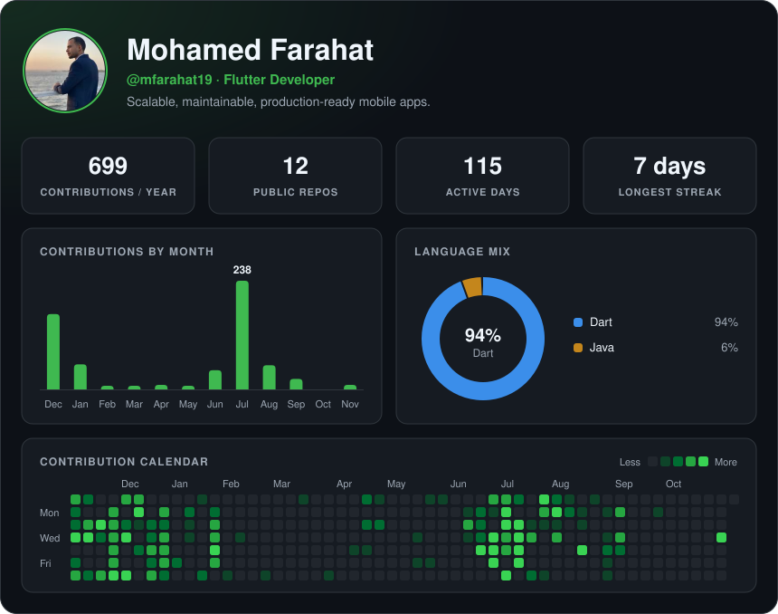

  

## About

Flutter developer building mobile apps with Clean Architecture, BLoC, and Firebase or Supabase backends. Currently also working with AI agents, MCP, and automation.

## Tech stack

## Featured projects

| Project | Description | Stack |
| --- | --- | --- |
| [MovieApp](https://github.com/mfarahat19/MovieApp) | Movie browsing app | Flutter |
| [IslamiApp](https://github.com/mfarahat19/IslamiApp) | Islamic companion app | Flutter |
| [Ecommerce-App](https://github.com/mfarahat19/Ecommerce-App) | Online shopping app | Flutter |
| [Clean-Architecture-Repo](https://github.com/mfarahat19/Clean-Architecture-Repo) | Clean Architecture in practice | Dart |
